# Earthship Console UI

A custom household dashboard for our off-grid Earthship's openHAB system —
weather, battery/solar, passive-thermal loop, and greywater on one pane of
glass, styled after the Ambient Weather WS-2000 console.

**Primary device:** Lenovo Tab M9 (2023), landscape (1340×800), wall-mounted.
The supported laptop floor is 1280×720. These landscape targets use bounded console
layouts; Earthship diagnostics scroll inside their page. Phone layouts are not
qualified.

**Stack:** Svelte + Vite + Tailwind, ECharts. Talks only to openHAB REST +
SSE through the same-origin LAN proxy, with curated local forecast reports.
This is a browser dashboard; no PWA manifest, service worker or offline-control
cache is implemented.

**Status:** implemented and running on the household LAN. Six tablet-first
screens provide live monitoring, safety-gated controls, and a shade preview.

## Screenshots

Refreshed October 24, 2026 at the primary Lenovo Tab M9 landscape viewport
(1340×800). Monitoring screens, Controls and detail modals show the live
household console. Shade images crop to an isolated synthetic preview with
unconfigured shades. Capturing these images sends no control commands.

### Home

[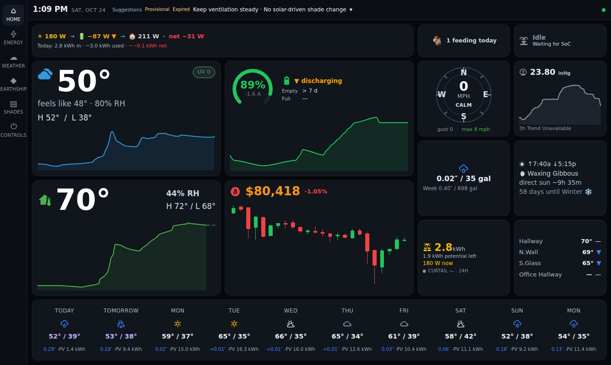](docs/screenshots/home.png)

### Energy

[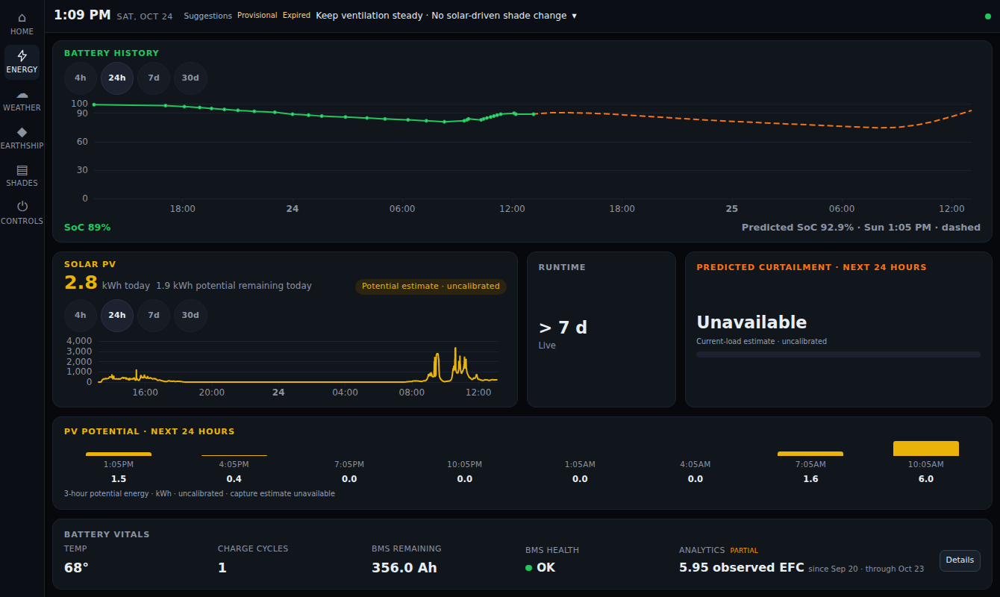](docs/screenshots/energy.png)

### Weather

[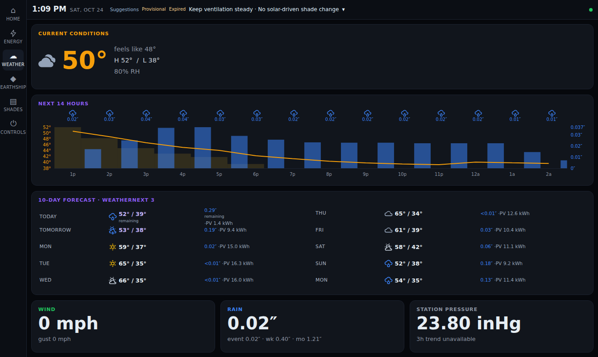](docs/screenshots/weather.png)

### Earthship

[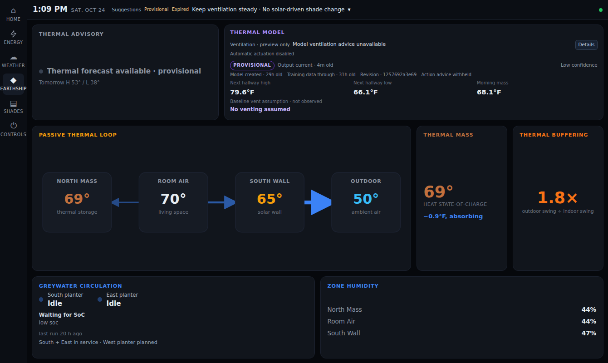](docs/screenshots/earthship.png)

### Controls

[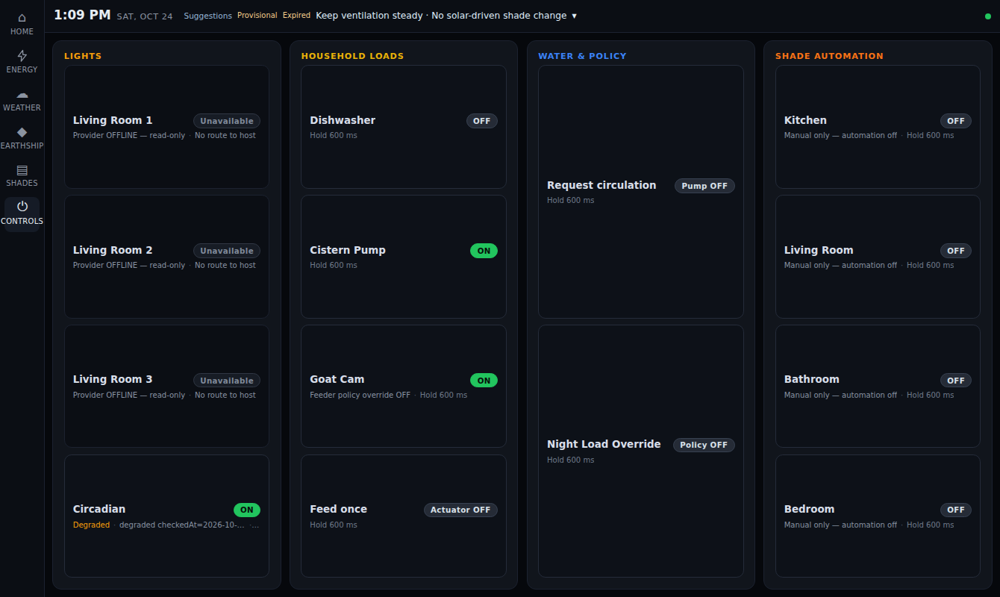](docs/screenshots/controls.png)

The four zone preferences live under **Controls → Shade Automation**, using the
standard **600 ms hold** and ON/OFF/Unavailable status pills. Each card shows
the saved choice and the backend status for commissioning, release and nighttime
policy. Automation preferences are separate from the shade preview.

### Window shades — Kitchen and Living Room

[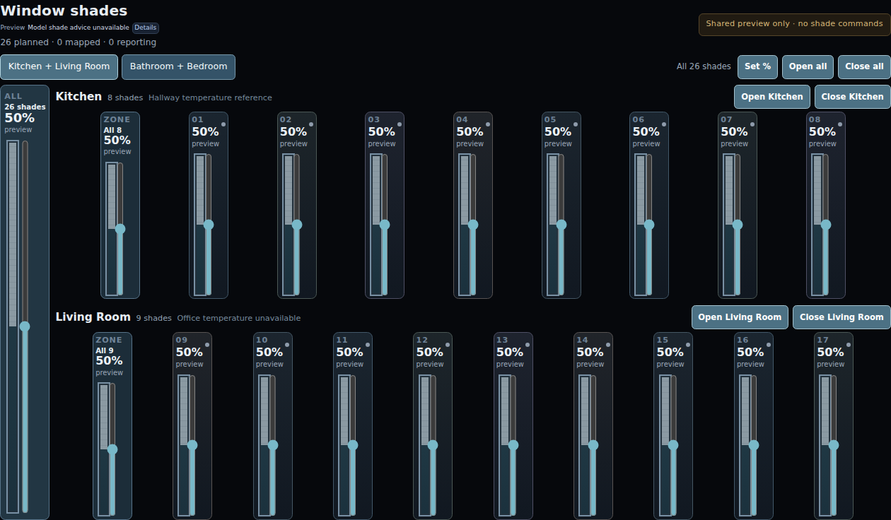](docs/screenshots/shades-kitchen-living.png)

### Window shades — Bathroom and Bedroom

[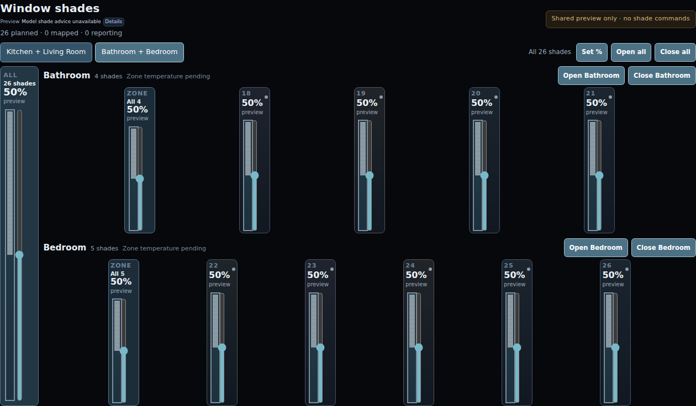](docs/screenshots/shades-bathroom-bedroom.png)

### Window shades — precise adjustment

[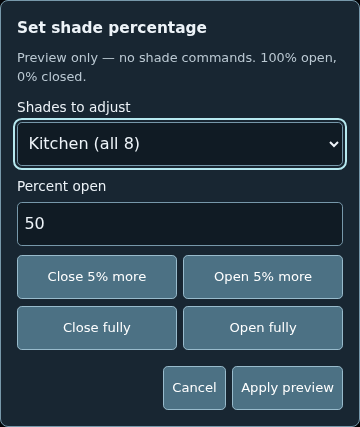](docs/screenshots/shades-percentage-editor.png)

The 26 shade slots and their all/zone/individual controls are preview-only
until hardware is mapped and commissioned. **Set %** selects an individual,
room, or all shades for exact percent-open entry, five-point steps, or full
open/close. Apply changes only the shared preview; Cancel leaves it unchanged.
Kitchen has 8 shades (1–8), Living Room 9 (9–17), Bathroom 4 (18–21),
and Bedroom 5 (22–26). Automation switches are on Controls; the Shades page
keeps preview, observation and commissioned manual-control views.
Regenerate these three images with
`node scripts/capture-shades-screenshots.mjs`.

### Detail modals

Tapping a tile opens its full history chart (with high/low extrema markers);
tapping a forecast day opens an hourly breakdown.

#### Outdoor temperature chart

[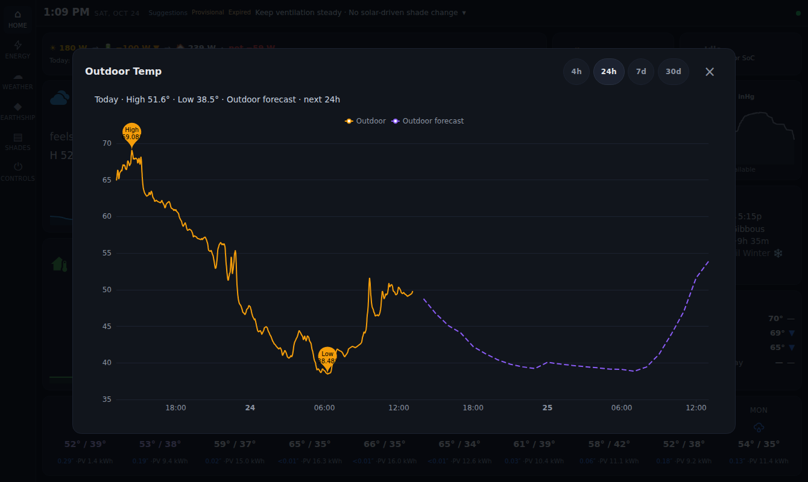](docs/screenshots/modal-outdoor-chart.png)

#### Battery SoC chart

[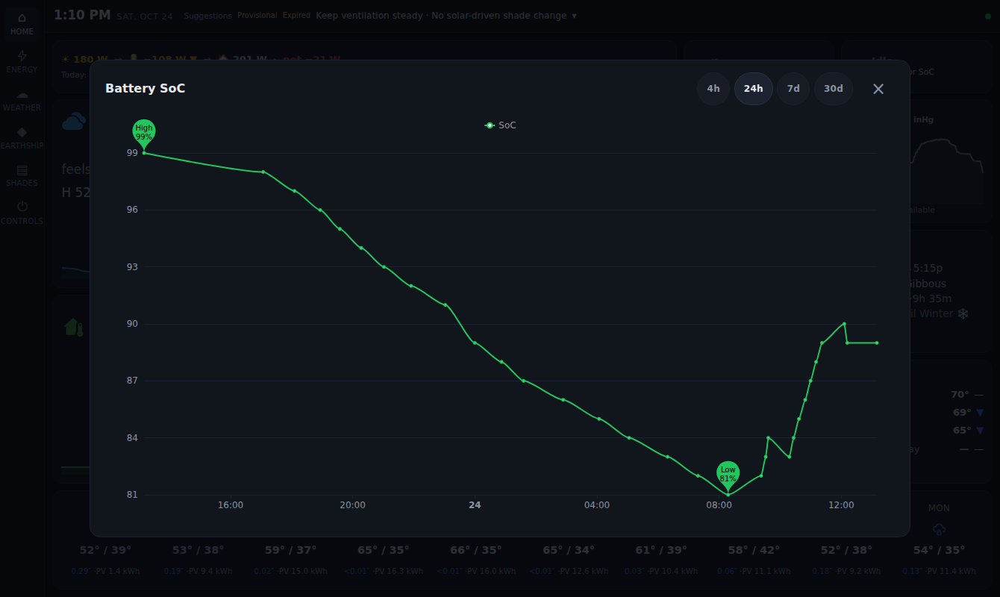](docs/screenshots/modal-battery-chart.png)

#### Weather day detail

[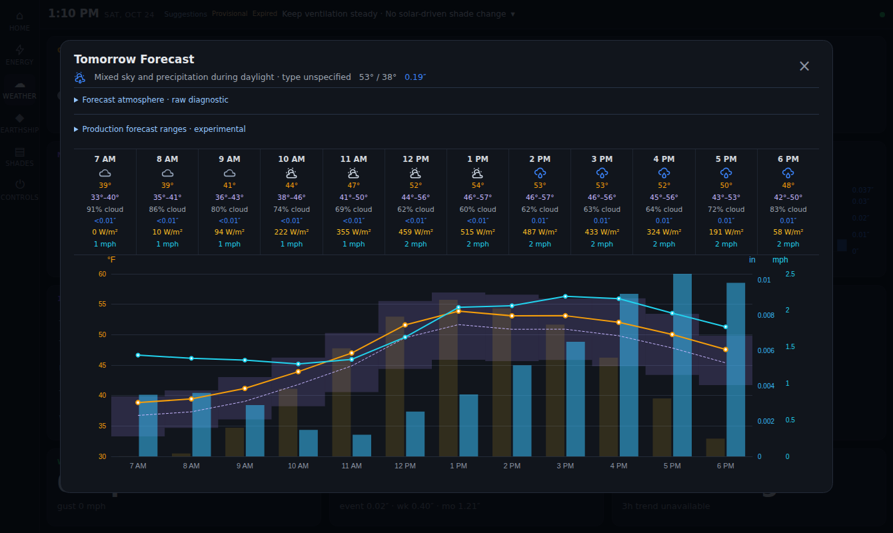](docs/screenshots/modal-weather-detail.png)

## Service operations

The household runtime is the user-level `earthship-ui.service`, which serves
the Vite application on port 5190 from an installed release directory. Inspect
the selected package before changing it:

```bash
systemctl --user show earthship-ui.service -p WorkingDirectory -p ExecStart
```

Reload the installed unit definition and restart the service:

```bash
systemctl --user daemon-reload
systemctl --user restart earthship-ui.service
systemctl --user status earthship-ui.service --no-pager -l
```

Inspect recent logs:

```bash
journalctl --user -u earthship-ui.service -n 100 --no-pager
```

Verify that Vite is transforming Svelte modules:

```bash
curl --fail --silent --show-error --output /dev/null \
  http://127.0.0.1:5190/src/App.svelte
```

Pulling commits or switching branches does not deploy the current checkout.
Prepare and verify a new release, preserve private runtime configuration and
overlays, then update the service’s release path and restart only the UI.
Restarting the existing unit reloads its selected package. Vite hot reload is
not a deployment substitute; an OpenHAB or broker restart is not required.

### Historical thermal shadow operations

The original first-install workflow staged daily training and two-hour publishing
units named `thermal-model-{train,shadow}.{service,timer}`. These historical notes
and their linked runbook do not select the current runtime package; use the newer
learning closures below for current implementation status. In that workflow,
implementation alone did not install or enable the units. Its thermal output remained
observational: it publishes only `Thermal_Model_JSON`, does not change
`Thermal_Advisory`, and has no actuator authority.

Thermal identification uses a rolling 400-day window so accepted artifacts
retain fall-charge, winter, spring, and warm evidence. The private artifact is
`earthship-thermal-model/v2`: its north-wall mass equation includes a bounded,
nonnegative mass-to-outdoor exchange, and v1 artifacts fail closed pending
retraining. The public shadow payload remains observational version 1. The attended runbook also
stages the hallway Philips sensor as `LivingOffice_Shade_Illuminance`,
`LivingOffice_Shade_Occupancy`, and `LivingOffice_Shade_Temperature`; collection
starts through the existing JDBC wildcard policy, with no photosensor-derived shade labels
in this change.

Use the attended, approval-gated
[thermal model shadow runbook](docs/operations/thermal-model-shadow.md) for the
exact tracked-to-live manifest, least-privilege PostgreSQL setup,
receipt-bound offline rehearsal, apply/closure/rollback, manual evidence review, service/timer
staging, durable transaction recovery, and rollback. The procedure is
first-install-only; if any thermal unit is already present, stop and use a
separately reviewed upgrade procedure. Completing implementation or collecting
shadow evidence does not graduate the model to advice.

## Current household ML and PV work

The [household program tracker](docs/operations/household-program-progress.json)
records the architectural scope and October 16 checkpoint. The newer
[October 20 learning closure](docs/operations/2026-10-19-historical-model-learning.md)
and [WeatherNext closure](docs/operations/2026-10-19-forecast-closure.md) supersede
its historical forecast/PV implementation pending notes. The earlier
thermal shadow instructions above describe their original first-install path.

- [Consumption and battery storage](docs/operations/2026-10-15-household-power-flows.md): deployed source-bound flow separation and natural replay evidence.
- [PV forecast practice](docs/operations/2026-10-15-pv-forecast-practice.md): array geometry, shared thermal/PV solar inputs, recovery-day diagnosis and remaining forecast implementation.
- [Shared job resources](docs/operations/2026-10-14-shared-job-resources.md): combined production/development resource coordination.

Canonical electrical-system meaning and measured array geometry also live in
Solar_PV's `docs/architecture/current-system.md` and
`docs/operations/pv-forecasting.md`. Geometry-aware PV, same-issue storage forecasts
and dedicated PV-potential accuracy reporting are implemented. Their provisional
physical assumptions and prospectively eligible outcome coverage remain explicit;
software deployment does not establish forecasting skill.

## Config (not committed)

Browser config lives in `config.json` and is browser-readable. Use an empty
`openhabUrl` for the same-origin proxy and keep `apiToken` empty. Set any actual
OpenHAB credential only in the server's private `OPENHAB_TOKEN` environment.
Copy `config.example.json` for non-secret browser settings; keep private host
configuration outside the repository.

## Distributed sensor observations

The retained LoRaWAN service and transport-independent registry are documented in
[the sensor runbook](docs/operations/lorawan-sensors.md). The uncommissioned sensor
tab was [retired on October 19](docs/operations/2026-10-19-home-energy-chart-recovery.md);
old `#/ventilation` links open Earthship. The retained `Ventilation.svelte`
component is exercised separately in a disposable synthetic harness, without
restoring the retired route or claiming physical commissioning. See
[validation](docs/operations/lorawan-validation.md) and
[future water, greenhouse and property sensing](docs/operations/sensor-expansion.md).

## Verification

`npm run test:unit` and `npm run build` verify the frontend. With Chromium
installed, `npm run test:e2e` runs the isolated general browser fixtures and
`npm run test:geometry` runs the existing console layout suites. These commands
exclude the separately owned sensor integration project explicitly.

`SENSOR_INTEGRATION=1 npm run test:e2e:sensors` requires the disposable sensor
Compose stack and its pinned Python environment from the sensor runbook. Without
that explicit integration environment, sensor execution fails rather than silently
skipping. Synthetic software qualification does not commission real radios.
