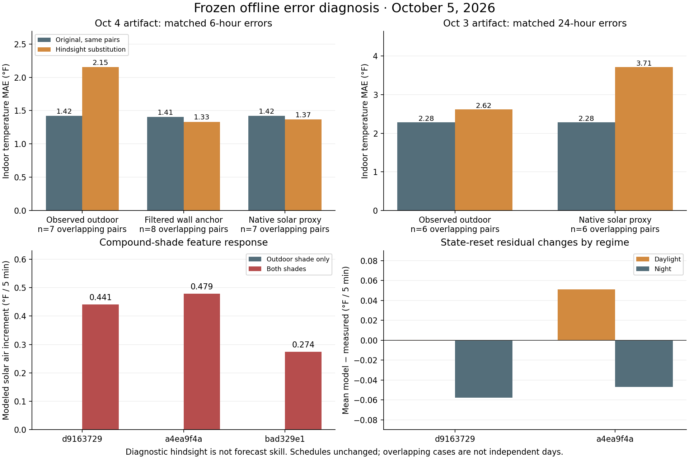

# October 5 thermal model: offline error diagnosis

The original forecasts reproduce exactly, but the installed model has a confirmed
compound-shade feature problem, a confirmed mismatch between observed and forecast
mass semantics in the plot, and residual errors that vary between day and night.
Replacing weather inputs or adjusting one scalar does not consistently repair the
misses. These findings prioritize model qualification; they do not establish a
released improvement or confirmed household action outcomes.

## Findings and implications

### 1. The installed solar features discard outdoor shading when indoor shading is closed

The installed `thermal_model.dynamics._solar_terms` has three features:

```python
unshaded = (1 - indoor) * (1 - outdoor)
indoor_closed = indoor
outdoor_shaded = (1 - indoor) * outdoor
```

For both shades closed, the outdoor feature becomes zero and the model uses the
indoor-only coefficient. In all three captured artifacts, the fitted outdoor-only
solar gain is approximately zero while the indoor-only gain is positive. Therefore
adding the indoor shade to an already shaded exterior increases modeled air heating
at the same radiation and time. A pure feature probe confirms this behavior:

| Artifact | Original forcing point (MDT) | Clear-sky fraction | Outdoor-only solar air increment | Both-shade increment |
|---|---|---:|---:|---:|
| d9163729 | 2026-10-03T17:25:00-06:00 | 1.3000 | approximately 0 | 0.4412 |
| a4ea9f4a | 2026-10-04T18:30:00-06:00 | 1.3000 | approximately 0 | 0.4786 |
| bad329e1 | 2026-10-05T09:00:00-06:00 | 0.7700 | approximately 0 | 0.2740 |

Increments are °F per five-minute model step, not a measured temperature rise or a
claim about physical shade effects. Each row uses that artifact's own original
forcing point; the rows are not a comparison of model improvement. All 19 original
captures use reconstructed action labels. The diagnosed cohort trajectories include
both `(indoor=0, outdoor=1)` and `(indoor=1, outdoor=1)` regimes. Actual household
shade positions are not established by these schedules.

The source repository already contains a four-regime candidate in
[`joint_solar.py`](../../openhab/scripts/thermal_model/joint_solar.py), including
`indoor * outdoor` and gain-order constraints. It is absent from the frozen
installed runtime. Existing coefficients must not be reinterpreted under those
new features; a versioned refit and chronological qualification are required.

Solar normalization is a related investigation target. The installed model uses
`1000 * clear_sky_fraction`, not absolute irradiance. Original late-afternoon
forcing can reach the 1.3 fraction cap even at low absolute radiation: the Oct 4
18:30 MDT probe has 62 W/m² and fraction 1.3. That is a verified feature behavior,
not proof that it caused a particular forecast miss. At that actual modeled time
the indoor shade was open, so the large *both-shade probe* contribution must not be
misrepresented as the contribution in the original forecast.

### 2. Observed and forecast mass use different quantities in the displayed plot

Installed `thermal_intel._current_states` seeds forecast/current mass with
`dataset.latent_mass_from_series`: a causal north-wall observer with a two-hour
time constant. However, `_aligned_observed_history` places raw north-wall values
in observed `massF`. [`ThermalModelPlot.svelte`](../../src/lib/ui/ThermalModelPlot.svelte)
draws both as “Mass” with solid observed and dashed forecast lines. An apparent
mass miss in that plot therefore includes a measurement-definition mismatch.

This diagnosis compares projected mass against the same causal observer, seeded
from the original captured filtered state. Independent installed-observer checks
match **3,420** valid points and **88** latest-state checkpoints, including native
restart behavior after explicit missing-wall barriers. A preliminary raw-wall
comparison was rejected and is preserved separately; none of its conclusions are
used here. The filtered wall proxy still does not measure whole-building thermal
mass. This plot finding does not invalidate the qualified indoor-air outcomes.

### 3. Weather temperature error alone does not explain the original misses

Diagnostic substitutions use measured future outdoor temperatures, native solar
proxy values, or causal filtered-wall anchors while holding original action
forcing and coefficients fixed. They are hindsight tests, not forecasts.
Every comparison below uses the same endpoint pairs for its original and changed
run. Missing required prefix observations withhold the endpoint, without filling.

| Cohort / horizon | Substitution | Matched overlapping pairs | Original → diagnostic MAE (°F) | Same selected non-overlap windows |
|---|---|---:|---:|---|
| Oct 4, 1h | Observed outdoor | 11 | 0.5030 → 0.6555 | 0.5030 → 0.6555 (n=11) |
| Oct 4, 6h | Observed outdoor | 7 | 1.4203 → 2.1530 | 0.7373 → 1.5790 (n=3) |
| Oct 3, 24h | Observed outdoor | 6 | 2.2828 → 2.6162 | 0.4860 → 1.5810 (n=1) |
| Oct 4, 6h | Filtered wall anchor | 8 | 1.4054 → 1.3324 | 0.8782 → 0.9437 (n=4) |
| Oct 4, 12h | Filtered wall anchor | 2 | 1.3190 → 0.8285 | 1.3190 → 0.8285 (n=2) |
| Oct 4, 6h | Native solar proxy | 7 | 1.4203 → 1.3656 | 0.7373 → 1.2510 (n=3) |
| Oct 3, 24h | Native solar proxy | 6 | 2.2828 → 3.7102 | 0.4860 → 1.8560 (n=1) |

All seven matched Oct 4 six-hour outdoor substitutions lose individually. The
three selected non-overlap windows also worsen. This means outdoor forecast errors
can compensate for structural model or action-assumption errors; it does not mean
measured weather is less accurate. The native radiation series is a lux-derived
proxy, not independently calibrated irradiance. Its mixed results do not justify
a sensor scale correction or use of observed future radiation in a skill claim.
Filtered-wall anchoring has mixed effects and no complete daily prefix here.

Two contrasting original misses are especially informative:

- **Oct 3 17:53:37Z issue → Oct 4 18:00Z daily target:** original indoor error
  **−7.750 °F**, cycle −1.260, persistence −0.360, outside the original interval.
  Substituting observed outdoor history changes the error to **−8.052 °F**;
  native solar proxy to **−8.662 °F**. A missing north-wall point withholds the
  full mass-anchor substitution. Weather replacement does not repair this miss.
- **Oct 4 18:00:04Z issue → Oct 5 00:00Z six-hour target:** original indoor error
  **+5.234 °F**, cycle −1.080, persistence −3.420, outside the original interval.
  Observed outdoor history gives **+5.238 °F**, filtered-wall anchoring +4.629,
  and native solar proxy **−1.963 °F**. The original schedule models both shades
  closed from 12:05 through 17:55 MDT, then indoor shade open at 18:00. This
  directly exercises the legacy compound-shade feature, but reconstructed actions
  prevent unique physical attribution of the error.

### 4. Day/night residuals reject a universal bias correction

A diagnostic one-step check resets air and filtered-wall state to qualified
preceding observations, retaining the original forcing. It excludes the first
partly elapsed step. Its 3,401 steps overlap across forecast windows and must not
be treated as independent samples or multiplied into a free-running daily error.

| Artifact / regime | Overlapping steps | Mean observed air change (°F/5 min) | Mean model change | Mean model − observed |
|---|---:|---:|---:|---:|
| d9163729 / night | 1037 | -0.065786 | -0.123535 | -0.057749 |
| a4ea9f4a / night | 940 | -0.067787 | -0.114786 | -0.046998 |
| a4ea9f4a / day | 431 | +0.027146 | +0.078076 | +0.050930 |
| bad329e1 / day | 10 | +0.054000 | +0.116865 | +0.062865 |

Both older artifacts cool too quickly in these night checks, while the Oct 4
artifact heats too quickly in daylight. Unconfirmed actual actions prevent
assigning all night residuals to physical coefficients. No additional ventilation
calculation or scenario is introduced.

Removing the constant air bias makes Oct 4 six-hour MAE **1.3845 → 2.1675 °F**,
its first daily error **+0.067 → +3.422 °F**, and the older first 48-hour error
**+0.943 → +5.930 °F**. A smaller +0.005 °F/step bias perturbation improves the
Oct 4 overlapping twelve-hour MAE, but slightly worsens its two selected
non-overlap windows (**1.3190 → 1.3225 °F**) and worsens the new-fit short outcome.
A global solar reduction also reverses its apparent benefit across overlapping
versus selected windows. None is a justified correction to deploy.

## Original forecast outcomes remain distinct from diagnostic hindsight

The frozen assessment is **Oct 5 15:04:42Z** for older cohorts. The new-fit first
one-hour target uses a separate qualified assessment at **15:07:44.750215Z**,
keeping the earlier assessment clock intact. There are 56 mature endpoint pairs
from 19 captured issues across three artifacts; horizons and overlapping windows
must not be pooled into a larger independent-day count.

| Cohort / artifact | Horizon | Pairs / non-overlap windows | Model MAE (°F) | Recent-cycle MAE | Persistence MAE |
|---|---|---:|---:|---:|---:|
| Oct 3 / d9163729 | 1h | 6 / 6 | 0.8028 | 0.9600 | 1.7700 |
| Oct 3 / d9163729 | 6h | 6 / 2 | 1.4795 | 4.6800 | 8.3400 |
| Oct 3 / d9163729 | 12h | 6 / 1 | 1.0598 | 4.5300 | 8.2500 |
| Oct 3 / d9163729 | 24h | 6 / 1 | 2.2828 | 1.1100 | 0.5400 |
| Oct 3 / d9163729 | 48h | 1 / 1 | 0.9430 | 0.9000 | 0.0000 |
| Oct 4 / a4ea9f4a | 1h | 12 / 12 | 0.5238 | 0.4950 | 1.0200 |
| Oct 4 / a4ea9f4a | 6h | 10 / 4 | 1.3845 | 3.0780 | 6.0480 |
| Oct 4 / a4ea9f4a | 12h | 7 / 2 | 0.9804 | 4.0371 | 7.7400 |
| Oct 4 / a4ea9f4a | 24h | 1 / 1 | 0.0670 | 0.1800 | 0.5400 |
| Oct 5 / bad329e1 | 1h | 1 / 1 | 0.5840 | 0.3600 | 0.5400 |

The first Oct 5 `bad329e1...` target at **15:00Z** observes **68.180 °F** versus
model **68.764**, strictly prior-cycle baseline **67.820**, and persistence
**67.640**. Signed errors are **+0.584/−0.360/−0.540 °F**, within the original
model interval. Observed outdoor substitution improves model error to +0.492;
filtered-wall anchoring to +0.577; both to +0.489. One case does not establish
improved accuracy, and the original model loses to both baselines on that case.

The accepted historical report has 1,012 prediction records, all reconstructed,
using changing chronological fold models. Its 119 daily air comparisons still
score model/cycle/persistence MAE **2.17855/1.83416/1.689895 °F**. Historical
interval coverage remains **0.81356**, below nominal 0.9, with 118 scored cases.
Final accepted parameters must not be applied to those old targets and counted
as prospective skill. Genuine action training/evaluation/disjoint counts remain
zero in the accepted artifact. Graduation remains open.



[Aggregate plot data](figures/2026-10-05-thermal-offline-errors.csv) contains only
summary results. The private capsule also retains the standalone PDF and qualified
trajectories; raw household histories are not added to the repository.

## Next accuracy work, in priority order

1. Align the displayed observed mass with the forecast's observer semantics, or
   explicitly label the two quantities, preserving raw sensor history separately.
   Qualify this against known gap/restart cases rather than treating a plot offset
   as a fitted physical error.
2. Qualify the existing versioned four-regime shade candidate with its own refit;
   examine solar normalization by time/elevation and require independent known
   shade states. Keep unknown states unknown. This diagnosis establishes the
   legacy feature problem, not that the candidate is ready for live use.
3. Evaluate day/night and multi-step errors by original artifact, issue date and
   selected non-overlapping window. Challenge any candidate against strictly
   prior recent-cycle and persistence baselines and original interval coverage.
   Reserve later naturally observed days as untouched validation.
4. Preserve origin-time action knowledge and collect genuine action outcomes
   through the approved confirmation workflow. Until then, model/state/forcing
   diagnostics cannot establish causal shade benefit or graduate action advice.

These are diagnostic priorities, not a deployed plan change. The configured
no-venting default starts Nov 1, 2026 at 00:00 America/Denver and persists until
the user changes it. Original captured ventilation forcing is held unchanged throughout. No
credential rotation, manual training/publisher, production restart, household
control, synthetic label, Nostr request or promotion is part of this diagnosis.

## Reproduction and evidence

Private capsule:
`/home/sat/.local/state/thermal-intel/qualification-receipts/offline-error-diagnosis-20261005/`
(directory mode 0700, files 0600, 94 hashed files plus final manifest; no credentials).
It contains frozen installed Python source, original immutable captures and model
files, qualified readings/receipts, prior baseline audits, supplemental clocks,
corrected/repeated results, scripts and independent validation. Explicit missing
sources remain barriers: north-wall at Oct 4/5 02:05Z, outdoor/radiation at Oct 5
00:20Z. The new-fit solar-proxy check is also withheld for its incomplete prefix.

| Evidence | SHA-256 |
|---|---|
| Installed runtime revision | `e32fdb8b785014a43aaf6343eb70bb392a3836789ccb3d8bb0a4f749e5e34fe9` |
| Accepted file | `acf1d315ef3a0ce1ec8ece8b74216afcf841f34c6f8e5a25986c8b7b567f6946` |
| Accepted backtest report | `6656af71a4b1e57c60d377a354340ab1fb7f52ca424805fca5a6456799a9d279` |
| Corrected result and identical repeat | `d5bb417b237df202c51c1340b3a5d255fcf0baa24bfaaac7f3783953e59641a8` |
| Independent validation | `3ec6474f96c0a659a497b10d1b5ac1a698fe53adf196138a96170ecd7f2ba4a1` |
| Compound-shade proof | `3e5e99f7eb4c971eb58decdf6b087c41100019630715ed22d2ea244979f344e4` |
| Final capsule manifest | `43faf8711ec61f7a9a4930a33d2905f905ba5e070710ba0fcd1cab93aaca9409` |

Both full diagnostic runs replay **19/19** original outputs exactly under the
explicit installed revision. All frozen source/model/capture hashes pass.
The corrected report is byte-identical on repeat. All parameter perturbations
pass the installed bounded physics validation, but that is not evidence of their
predictive benefit. External network/database calls are refused during the
calculation, and subprocess calls are refused after numerical-library import.

The scripts resolve their frozen runtime/capture copies beside themselves.
`python3 validate.py` checks the saved pair of reports and installed observer
parity. To regenerate, use a new private copy, remove the copied result output,
and run `python3 diagnose.py`; repeat with
`EARTHSHIP_DIAG_OUTPUT=diagnosis-repeat.json`. Relocation changes path metadata in
exact-replay proofs, so normalize only capture/runtime paths when comparing to
the saved report. Numerical environment: Python 3.12.3, NumPy 1.26.4, SciPy 1.11.4.
See the private `README.txt` and hashed `environment.json`.
