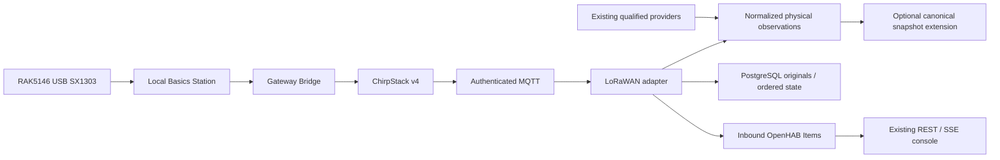

# Distributed sensor operations and commissioning

Status: hardware-independent software qualified October13,2026. The owner
authorized production activation and migrations on October16; the software
backend is now active. See the [activation receipt](2026-10-16-sensor-production-activation.md)
for exact deployed resources, verification and rollback. Physical commissioning
remains pending. PR #30 remains open and unmerged.

## Architecture and ownership

`services/observations` is the transport-independent metadata and physical-reading
boundary. `services/lorawan` is its first new transport adapter. Zigbee, RTL-SDR,
wired and OpenHAB providers keep their existing ingestion and qualified history.
`services/observations/provider.py` accepts existing `household.evidence.Observation`
objects and exact originals; it does not poll or replace a provider.



There is no actuator API, request channel, model training or live forecast change.
The control capability registry remains separate and unchanged. New observational
capabilities never confer control authority. The optional snapshot extension uses
existing immutable `HouseholdSnapshot`, codec and evidence conventions. Its new
schema cannot silently enter current model pipelines. All callers must opt in.

The October 7 architecture and merged PR #3 were read. Base is merged PR #28;
concurrent PR #29 changes household cycle delivery and was deliberately avoided.
Host inventory found authenticated Mosquitto at1883, PostgreSQL16 at loopback5432,
OpenHAB at8080, and an unrelated application's Redis at6379. Production templates
reuse host MQTT/PostgreSQL; only ChirpStack gets a dedicated Redis at6394. No second
production OpenHAB or MQTT server is proposed. New sensor originals use a dedicated
`earthship_observations` schema in an operator-selected existing database. Existing
JDBC and thermal journals remain authoritative; no duplicate backfill is created.

## Registry and observation contracts

Authoritative validators: `services/observations/registry.py` and `contract.py`.
Schema artifacts are in `services/observations/schemas/`.

`deploy/lorawan/registry.production.json` starts empty. Replace the example
application UUID with the real ChirpStack application ID before commissioning.
The synthetic registry provides15 openings, a gate and5 environmental devices.
It is **not a real physical map**.

A registry entry has logical and physical identity, transport, display name,
location, zone, device type, observational capabilities/types/units, decoder,
hardware epoch, commissioning flags, supervision thresholds and battery policy.
Optional firmware, protocol, calibration, relationships and security policy are
metadata. Use `source_verified` for general source qualification; `radio_verified`
records the LoRaWAN commissioning result. Enabling a device does not qualify it.

Supported units/types include binary contact, tamper, leak and motion; temperature
in degC; humidity and calibrated moisture in percent; raw moisture in raw units;
water depth in metres; flow in L/min; cumulative water in litres; pressure in kPa;
pump runtime in seconds; conductivity in mS/cm; light in lux and CO2 in ppm.
Add a new physical type and source-specific validation together. Derived volume,
forecast outputs and actuator state do not become physical measurements by naming.

Normalized `earthship-observation/v1` readings carry exact type/unit, nullable
physical observation time, receipt time, validity interval, timestamp basis,
source identity, source/hardware epochs, raw SHA256, quality and synthetic flag.
A reception timestamp is not an exact physical transition timestamp. Contact
receipts additionally preserve decoder revision, fCnt, event classification,
battery, tamper, RSSI/SNR and the immutable raw-journal reference. Raw bytes are
stored as base64. Oversized rejected inputs preserve their full digest and a
bounded prefix, not a claim that truncated bytes are a full original.

`earthship-sensor-view/v1` is a derived, expiring OpenHAB presentation receipt,
not a replacement for original readings. It contains last-known state separately
from current state/validity, diagnostics, recent events, bounded daily estimates,
normalized readings and operational health. Never interpret UNKNOWN as CLOSED.

## Documented decoder profiles

All profiles are **manufacturer documented, not radio verified**. Compare actual
firmware samples, FPort and installed contact polarity during commissioning.

| Profile | Implemented payload | Important distinction |
|---|---|---|
| `dragino_lds02/v1` | FPort10,10bytes, mode1: high contact bit,14-bit millivolts, counters/duration | EDC FPort7 describes counting mode, not current contact; refused |
| `milesight_ws301/v1` | FPort85 TLV channels: battery percent, magnet, tamper and documented basic metadata | Magnet0=CLOSED,1=OPEN; tamper is separate |
| `dragino_ds03a_lb/v1` | FPort2 single-channel11bytes, FPort3 datalog records, FPort5 device/battery status | Contact bit0; device UTC clock; status-only packets do not refresh contact |

DS03A dual-channel18-byte mode and unrecognized WS301 channel/firmware variants
are explicitly refused. Datalog is archived without replacing current contact.
Unknown, duplicate or truncated TLVs fail closed. No network-supplied decoded
object is trusted in place of locally decoding raw payload bytes.

Manufacturer sources checked October13,2026:

- [LDS02 manual](https://wiki.dragino.com/docs/LoRaWAN-End-Node/door-water-leak-contact-sensors/lds02/)
- [WS301 user guide](https://resource.milesight.com/milesight/iot/document/ws301-user-guide-en.pdf)
- [WS301 manufacturer decoder](https://github.com/Milesight-IoT/SensorDecoders/blob/main/ws-series/ws301/ws301-decoder.js)
- [DS03A-LB/LS manual](https://wiki.dragino.com/docs/LoRaWAN-End-Node/door-water-leak-contact-sensors/ds03a-lb/)

## Isolated development and demonstration

Requirements: Docker Compose, Python3.12, repository Node dependencies. Set
`LOCAL_UID=$(id -u)` and `LOCAL_GID=$(id -g)` in the shell when they differ from1000. Commands
below operate only the named disposable development project. Do not substitute
production endpoints or copy existing OpenHAB userdata/credentials.

```bash
python3 -m venv --system-site-packages /tmp/earthship-sensor-test-venv
/tmp/earthship-sensor-test-venv/bin/pip install -r services/lorawan/requirements.txt
python3 -m services.lorawan.provision
```

Provisioning creates random development-only account/password files, hashed MQTT
passwords, ACLs, SQL and generated OpenHAB files inside ignored `.superpowers/lorawan-private/`.
It refuses to overwrite existing credentials. Keep that parent directory0700;
service JSON0600. PostgreSQL init SQL and Redis config are0644 inside the0700
parent so their distinct container UIDs can read individual bind-mounted files.
Never move those files into a world-readable parent or commit them.

Acquire version-matched OpenHAB5.2.1 offline addons before starting. For example:

```bash
curl -fL https://openhab.jfrog.io/artifactory/libs-release-local/org/openhab/distro/openhab-addons/5.2.1/openhab-addons-5.2.1.kar \
  -o .superpowers/lorawan-private/addons/openhab-addons-5.2.1.kar
chmod 644 .superpowers/lorawan-private/addons/openhab-addons-5.2.1.kar
docker compose -f deploy/lorawan/compose.test.yaml up -d --build
docker compose -f deploy/lorawan/compose.test.yaml --profile chirpstack up -d redis chirpstack
docker compose -f deploy/lorawan/compose.test.yaml --profile simulation run --rm simulator
```

Pinned images/digests are tracked in Compose/Dockerfile. Cache images, Python
wheels and addon KAR before disconnecting internet. Services themselves use no
cloud endpoint. The database/ingester network is internal; loopback-only published
management ports use a separate bridge. The optional simulator joins then reports
16 independent contact devices plus environmental observations, battery warning,
tamper, duplicate, ordering and corrupt-payload events. Unit replay supplies long
quiet periods, packet gaps, late datalog, replacement and expiry. Container tests
supply genuine broker, ingestion and database outages. These are software tests,
**not physical LoRaWAN or gateway qualification**.

The Compose simulator reads `registry.simulation.json`; `--registry` also selects
a validated simulation registry for the standalone CLI. Device identities, the
application ID and documented LDS02, DS03A-LB or WS301 contact profiles come from
that registry. Change the registry before private provisioning so MQTT ACLs and
OpenHAB definitions agree. The simulator refuses a production registry.

Test endpoints: MQTT127.0.0.1:18884; OpenHAB127.0.0.1:18084;
ChirpStack127.0.0.1:18085. ChirpStack's default `admin/admin` exists only in this
isolated instance. Production management password must be changed before exposure.

To view the demonstration without production equipment:

```bash
OPENHAB_PROXY_TARGET=http://127.0.0.1:18084 npm run dev -- --host 127.0.0.1 --port 5194
```

Create ignored `public/config.json` with `{"openhabUrl":"","apiToken":"","staleBannerSeconds":90}`
in this isolated checkout. Open `http://127.0.0.1:5194/#/ventilation`. Browser tests
supply this configuration in memory. All screen data uses the existing OpenHAB
Item snapshot and SSE. No browser MQTT/ChirpStack connection or token is required.
Private staging uses the existing blocked `.superpowers` path, so credentials
remain protected even before the new Vite configuration is installed. SQLite
journals and legacy staging paths are also denied by the new file-server policy.

```bash
PYTHONPATH=.:openhab/scripts python3 -m pytest services/lorawan/tests openhab/scripts/test_household_sensor_observations.py
SENSOR_INTEGRATION=1 PYTHONPATH=.:openhab/scripts /tmp/earthship-sensor-test-venv/bin/python \
  -m pytest services/lorawan/tests/test_integration.py
SENSOR_INTEGRATION=1 npx playwright test tests/e2e/sensors-layout.spec.js
npm test
npm run build
```

End a demonstration with `docker compose -f deploy/lorawan/compose.test.yaml --profile chirpstack down`.
Volumes preserve simulated history; `down -v` deliberately destroys only this
project's disposable data. Never use global Docker prune. Do not delete private
credentials while preserving volumes and then generate new credentials blindly.

## Ordering, recovery and supervision

Only authenticated, registered ChirpStack application/device topics are accepted.
Both live and reconnect retained inputs are refused using MQTT5 retain-as-published
subscriptions. Outputs are retained but dated; consumers expire them independently.
Persistent MQTT sessions queue QoS1 during ingestion outages. Production Mosquitto
must have persistence enabled and sufficient queue limits; that change is staged,
not applied. The service commits before acknowledgment/publication. Database failure
terminates the process without acknowledging that uplink; restart redelivers it.
A PostgreSQL advisory lock permits one writer. Exact duplicates do not renew age.

Frame counters advance within a session. A newer authenticated join establishes a
barrier; unexplained regression, counter conflict or invalid payload withdraws current
contact until a new contact report. Status-only messages can renew communication
without renewing contact. A skipped frame invalidates an old contact unless the same
packet supplies a fresh contact, and interrupts duration history. Device-address,
join-time and hardware-epoch barriers prevent old-session state from silently winning.
Equal source times are ordered by deterministic committed journal sequence.

Configure contact/communication stale thresholds from the **commissioned actual
reporting interval**, then a larger offline threshold. The synthetic120/300-second
thresholds are for tests. LDS02's documented daily keepalive and DS03A's two-hour
contact reports mean their untouched defaults cannot provide rapid loss supervision.
A shorter reconciliation interval can improve supervision at a battery/airtime cost;
set it deliberately using manufacturer procedures. This code sends no configuration
downlinks. LoRaWAN provides neither guaranteed delivery nor fixed latency.

Ingestion handles immediate events;15-second sweeps are only health/expiry and
retry publication. The OpenHAB30-second supervisory rule updates Valid, Health and
Available, never the last-known Contact. The browser also expires45-second collector
receipts and device timestamps on its clock and observes service LWT. An offline
sensor never acquires a CLOSED reading from these mechanisms.

History queries are indexed by sensor and source time. Dashboard history is limited
to the latest5000 rows,48 events and256 daily rows; it explicitly reports this
coverage limit. `Store.history(sensor_id, limit=...)` and SQL support deeper extraction.
Open duration is a **supervised estimate**, censored at invalidation, packet gaps,
replacement and expiry, split at America/Denver midnight. It does not claim measured
airflow or exact physical transition times. No last-known state is bridged across
an unobserved gap to manufacture a complete interval.

## Production staging and authorization

For a fresh deployment, obtain authorization before activating production profiles.
The ThinkCentre cutover is recorded separately; these are the prerequisites:

1. Private broker ACL/account additions for ChirpStack, one gateway bridge,
   read-only OpenHAB, and ingest. ChirpStack publishes application events and
   gateway commands; ingest reads only configured application events/gateway stats
   and writes only `earthship/sensors/v1/#`. OpenHAB has no write grant. The simulator
   account/topics must not exist in the production policy.
2. A separate non-owner `sensor_writer` database role and owner-only migration.
   Review `python -m services.observations.migrate --admin-dsn-file ... --runtime-role
   sensor_writer --environment production` dry run. `--apply` requires explicit
   authorization. Runtime refuses database/environment mismatch. Provision a separate
   ChirpStack-owned database in the existing PostgreSQL server, with `pg_trgm` and
   `hstore` extensions. Do not give ingest schema-owner, CREATE, UPDATE-original or
   DELETE privileges.
3. Private production config under `private/production/`. Render placeholders in
   `config/chirpstack.toml` and `region_us915_1.toml`; set API bind127.0.0.1:18085,
   host MQTT127.0.0.1:1883 and Redis127.0.0.1:6394. Set `chirpstack_probe_url` to
   `http://127.0.0.1:18085/`. Ingest uses an existing-database DSN with its role.
   MQTT outside loopback requires a private CA and TLS; never use plain credentials
   across an untrusted segment. For trusted remote management, prefer an SSH tunnel
   or authenticated reverse proxy; do not expose the management API publicly.
4. Render inbound-only Things/Items/rule to a private staging directory:
   `python -m services.lorawan.generate_openhab --registry ... --mqtt ... --output ...`.
   Install MQTT, JSONPATH, REGEX and JS Scripting addons from cached version-matched
   artifacts. Use one file provider per new resource, verify no name/link overlap,
   then record file ownership only after authorized readback. Never copy demo
   userdata or synthetic retained state into production. Existing `ownership.json`
   is unchanged until an actual commissioned cutover.
5. Separate review for service activation, OpenHAB file installation and hardware
   gateway profile. Compose profiles `authorized-production` and `authorized-gateway`
   make activation explicit. They do not substitute for operator permission.

The optional household adapter requires exact registry, normalized originals,
source bindings and (for LoRaWAN) current exact collector supervision with matching
digests. It rejects synthetic, missing, expired, unverified, future or wrong-epoch
sources. A new fault cannot be masked by an older qualified contact receipt.
Install the shared `services/observations` package together with the optional adapter
and use canonical `PYTHONPATH=.:openhab/scripts`; do not introduce a second import
identity for household evidence classes. No active household cycle calls this adapter.

## RAK5146 commissioning checklist

The planned USB RAK5146 is a multichannel SX1303 concentrator. RAK's published
[Basics Station source](https://github.com/RAKWireless/basicstation) documents
AMD64/CoreCell USB support; its maintained container is published under
`xoseperez/basicstation`, whose selected digest is tracked. RAK's
[packet-forwarder reference](https://github.com/RAKWireless/udp-packet-forwarder)
documents USB paths such as `/dev/ttyACM0`. The exact purchased card's USB firmware,
reset behavior, adapter power and enumeration remain hardware qualification steps.
No GPS is required for the initial stationary Class A contact application; do not
promise Class B timing, geolocation or fine timestamp features without qualification.

- Verify the delivered **USB US915 non-LBT** part, adapter and915MHz antenna.
  Attach the antenna before transmission; record gain/cable loss and regional settings.
- Inspect `lsusb`, kernel `cdc_acm` messages and `udevadm info` for the actual card.
  Identify a stable by-id path or commission a narrowly matched `/dev/earthship-lora`
  symlink. Do not assume `ttyACM0` belongs to this card on a server with other USB gear.
- Confirm concentrator identity and supported USB HAL with device access limited
  to that port. No privileged container, wildcard USB bus or Docker socket mount.
  Verify permissions, USB power, cold boot and disconnect/reconnect independently.
- Render `gateway/gateway-bridge.toml.template`, create private mTLS CA/server/client
  certificates and station `tc.uri`, `tc.trust`, `tc.crt`, `tc.key`. Use local
  `wss://127.0.0.1:3001`; certificates must match that endpoint. Retain CA offline.
  The bridge binds loopback; no public Semtech UDP listener is needed.
- Confirm the selected Station image supports the purchased USB board and its
  reset/clock configuration. `station-overrides.json` is an overlay, not a runnable profile.
  `python -m services.lorawan.prepare_station --gateway-eui <eui> --output
  .superpowers/lorawan-private/production/station` extracts the full pinned vendor CoreCell
  profile without starting a forwarder, preserving radio calibration tables while
  selecting USB/no GPS. Compare that profile with the purchased board before TX.
  The Station directory must be writable: inspection confirmed its startup script
  creates USB reset helpers there, even with pre-existing configuration.
- Register gateway EUI as private in ChirpStack; align `us915_1` throughout.
  This is **FSB2**,125kHz channels8–15 (903.9–905.3MHz) and500kHz channel65
  (904.6MHz). Manufacturer sub-band numbers may use different indexing. Verify
  actual channel mask, join scan, RX1/RX2 and ADR, not just the word “US915”.
- Use OTAA and unique real DevEUI/JoinEUI/AppKey (and NwkKey when applicable).
  Keys live only in ChirpStack/private encrypted inventory. No frame-counter-check
  disabling as a recovery shortcut. Record firmware and exact FPort.
- Commission each magnet polarity, mounting separation, heartbeat, tamper and
  battery values. Capture raw uplinks for both states, reboot/rejoin and supervision.
  Populate real name/location/zone; only then record commissioning/source flags.
- For the distant gate, test terrain, berms, metal, foliage and seasons, antenna
  height and line of sight. Measure RSSI/SNR and actual missed-report rate across
  repeated walks/open-close trials. Do not infer reliable range from a bench test.
- Repeat host/gateway/broker cold boot, network outage and sensor recovery. Compare
  original payload, database decision, OpenHAB state and UI before activating any
  production monitoring. Qualification adds no pump, valve, shade or alarm authority.

Reference [ChirpStack Docker documentation](https://www.chirpstack.io/docs/getting-started/docker.html),
[regional configuration](https://github.com/chirpstack/chirpstack/blob/v4.19.2/chirpstack/configuration/region_us915_1.toml),
and [Gateway Bridge TLS configuration](https://www.chirpstack.io/docs/gateway-bridge/configuration.html).

## Health, logs and troubleshooting

`docker compose ... ps` and ingestion health file expose process/broker freshness.
OpenHAB receives operational metrics: accepted/rejected counts, decode/integration
failures, processing time and last event. Gateway ONLINE means recent authenticated
MQTT stats activity, **not RF coverage or qualified sensor state**. Missing gateway
stats become UNKNOWN/OFFLINE. `http_responding` for ChirpStack is only HTTP presence;
verify database migrations separately. The integration test checks tables and the
supported gRPC-web login because HTTP alone does not prove a working schema.

Logs contain decisions/durations, not payloads, names, passwords or keys. Docker
logs rotate. Raw evidence remains in the private journal for deliberate debugging.
MQTT queued-message/integration failures require inspecting broker persistence and
session policies. On decoder failures inspect exact firmware/FPort/bytes privately,
then add verified vectors to a new decoder revision; never flip polarity by guess.
On counter regression inspect OTAA join receipts. On stale Items verify service LWT,
source timestamps and OpenHAB transformations before changing supervision thresholds.
No live physical actions are necessary for software troubleshooting.

## Backup, restore and replacement

Back up the new schema and ChirpStack database using PostgreSQL custom-format dumps
under a private service account; encrypt output, check exit status and record digest.
Back up private registry/credentials, TLS CA and MQTT account/ACL configuration
separately. Persist Redis AOF and the broker session/retained store; these are recovery
caches, not substitutes for original sensor history. Never commit dumps or secrets.

Restore first to a disposable database/project, with runtime stopped. Verify original
row counts/digests, sequence uniqueness, environment metadata, role privileges,
ordering and a fresh synthetic event there. The real-container test performs a
`pg_dump`/`pg_restore` round trip into `sensors_restore_test`, then removes only that
disposable database. Production restore requires operator authorization and its own
receipt; do not replay old retained state as fresh evidence after restoring.

To restart after outage, restore DB/broker first, then ingest. Its ordering state,
seen IDs, session epochs and originals survive. Queued stale packets remain stale.
If configuration is rolled back, stop affected new services and remove only their
owned OpenHAB files, then restore the recorded provider definitions/credentials.
Retain journal schema/history; revoke runtime grants rather than deleting originals.
There is no production down migration that erases evidence automatically.

For replacement retain logical ID only when it truly represents the same opening,
use the new physical identity and a new nonzero hardware UUID, reset commissioning
flags, remove old network access and requalify. Old-epoch state/history does not
become the replacement's evidence. Disabling a device leaves originals available
but removes it from current projections. Never reuse join keys across devices.
